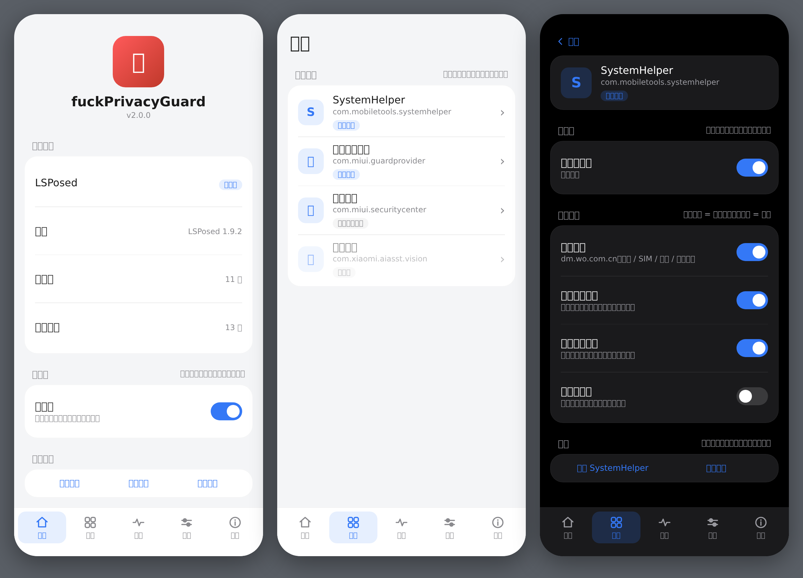

<div align="center">

# fuckPrivacyGuard


基于 LSPosed 的 HyperOS 隐私加固模块，在数据来源、本地存储、跨进程接口、网络出口四层拦截预装组件的上报行为

</div>

[简体中文](README.md) · [English](README.en.md)

以下内容基于对本机预装组件的静态分析与运行时观察：这些组件会采集设备标识、应用使用记录、位置、通话行为等信息，并通过网络或跨进程接口发出。本模块在这些通道上按应用分组拦截，开关与 LSPosed 作用域联动。具体行为以各自机型和系统版本上的观察为准。

> **维护节奏**：本项目由个人维护，长期成本由作者个人承担。更新频率已主动下调：只在出现影响使用的缺陷、发现新的上报通道或系统大版本适配时发版；界面、文案与小功能改动会并入下一次实质更新，不单独出包。issue 会看，但不承诺响应时间和实现排期，未确认的功能请求可能长期不做，或并入相近的改动一起处理。

改代码前建议先看 [AGENTS.md](AGENTS.md)（协作约定）与 [docs/ARCHITECTURE.md](docs/ARCHITECTURE.md)（结构与扩展步骤）。

本仓库即源码仓：`src/` 下是全部 Java 实现，`build.sh` 是完整构建脚本，用 `javac` + `d8` + `aapt2` + `zipalign` + `apksigner` 打包，不依赖 Gradle；`Releases` 里的 APK 由它构建。`Xposed-Modules-Repo/io.github.zeroedx.fuckprivacyguard` 只是 LSPosed 的索引仓库，只放 APK 与简介。

> 仅供个人在自有设备上学习研究使用。使用前请阅读 [DISCLAIMER.txt](DISCLAIMER.txt)。名称中的 Hyper 指 HyperOS 平台，本项目与小米、中国联通等厂商无隶属或合作关系。

## 独立应用与包名

自 2.0.0 起，本项目是**完全独立**的应用与 LSPosed 模块，不再与上游 HyperPGuard 共用包名与签名：

- applicationId / Java 包名：`io.github.zeroedx.fuckprivacyguard`
- 应用名称：`fuckPrivacyGuard`
- 签名：独立的正式签名证书（**非**上游的 `debug.keystore`）

因此**无法覆盖安装上游 HyperPGuard**，也无法用上游 APK 覆盖本项目：两者被视为不同的应用。首次从上游迁移时需**先卸载上游**再安装本项目，卸载会清掉旧作用域配置——LSPosed 的作用域**不会自动迁移**，需要在 LSPosed → 模块 → fuckPrivacyGuard → 作用域 里重新勾选目标组件。签名不同也意味着升级本项目时**只能由同一把新证书签名的包**覆盖安装。

## 当前支持的版本

- Android 10 – Android 17 的 HyperOS
- LSPosed 2.2.x（libxposed API 100+）
- Root：KernelSU / Magisk / APatch（「重启」「查看日志」需要）

> **Android 17 / SDK 37 / HyperOS 4**：已在 **Xiaomi 17 真机**（HyperOS 4 / arm64-v8a /
> LSPosed，libxposed API 102）上验证运行。这不代表所有机型或所有 Hook 都全面兼容：
> 已覆盖能力、尚未覆盖（Native / HAL、Binder / AIDL、麦克风、摄像头、蓝牙）与仍待验证项，
> 见 [兼容性与覆盖范围](docs/COMPATIBILITY.md)。实际拦截效果以各自机型上的观察为准。

## 安装

1. 安装 `fuckPrivacyGuard`
2. 在 LSPosed 中启用「fuckPrivacyGuard」
3. 打开应用；若当前作用域为空，会向 LSPosed 请求加入全部已安装的目标组件，允许即可，也可在 LSPosed 里手动勾选
4. 在模块里对目标应用点一次「重启」，或点批量行的「全部重启」，让它重新加载

作用域外的应用不会被注入。「重启」「查看日志」「自检」需要 root。

覆盖升级后，LSPosed 的作用域不会自动包含新增组件，需要到 LSPosed → 模块 → fuckPrivacyGuard → 作用域 里重新确认；漏勾时分类页该组件会标注「未加入作用域」，点进组件页可「点此加入」。

## 使用

**作用域开关**：分类页按系统组件列出各组件（名称 / 包名 / 安装状态 / 作用域状态），点进组件二级页，右上角就是该组件在 LSPosed 里的作用域开关；未加入作用域时组内子项置灰不可操作，并给出「点此加入」。

**子项开关**：每个组件页列出该组件的全部规则，可以只留某条，例如只要 XSOF 拦截就把域名层那项关掉。会影响系统功能的规则一律默认关闭，副标题写明代价。

**自定义规则**：内置表没覆盖的域名可以自己补，支持「域名」「域名/路径」和「类名#方法」三种写法：前两种作用于网络出口，第三种让指定方法直接返回默认值，用于内置 hook 因类名变化失配时应急。添加后需重启对应应用才生效。写法、匹配方式与限制见 [自定义规则使用说明](docs/CUSTOM-RULES.md)。

**配置同步**：开关改动经 LSPosed 的 RemotePreferences 通道下发到各目标进程，**不需要 root**；从旧版本升级时首次读取会回落一次旧的 `Settings.Global`，之后不再写入该系统设置。开关保持默认值时不会写进通道，通道里缺某个 key 不代表它关闭，以界面状态与日志为准。

**重启**：改完开关点「重启」执行 `am force-stop`，应用下次启动重新注入；批量行有「全部重启」。系统常驻组件被停止后通常几秒内会被系统拉起，等于自动完成重启。

**查看日志 / 分享日志**：读取本地 logcat 中本模块的输出，可导出分享。日志不包含电话号码、行为库内容或调用参数。

**记录未拦截访问**：记录「访问了但没被规则命中」的域名，用于补规则，平时保持关闭。

**关于 / 检查更新**：卡片底部列出 GitHub 仓库、LSPosed 模块页与 Issues 入口，点「检查更新」会向 GitHub API 取最新 release tag 与当前版本比对；不点就不发任何请求。

## 拦截层次

| 层 | 做法 |
|---|---|
| 网络出口 | Hook `URL#openConnection`、`InetAddress#getByName`、`Socket` 构造与 `connect`，规则为「域名后缀 + 可选路径」 |
| 隐私 API | 应用列表、使用记录、设备标识、短信发送、XMSF 代发广播，在数据来源处截断 |
| 行为库 | 按 `screenshot` / `screen_share` / `call_forwarding` / `airplane_mode` / `fraud_phone` / `voip_record` / `fraud_url` / `install_app` 八张表名拦 `SQLiteDatabase` 写入 |
| 静默录屏 | `MediaProjection#createVirtualDisplay` 不建立 |
| 方法层 | 反射定位方法后直接返回：SystemHelper 发送与入队、analytics 使用记录聚合 |
| XSOF | Provider / AIDL / 写库 / 评分四层，第三方查不到截图、通话、屏幕共享记录 |

方法层与网络层互不依赖：类名变化时域名规则仍在工作，域名更换时方法层仍在工作，日志能分辨是哪一层命中。

## 覆盖组件

| 组件 | 包名 | 拦截内容 |
|---|---|---|
| SystemHelper | `com.mobiletools.systemhelper` | 运营商设备管理 / 网络优化组件（非恶意软件；内置 UNICOM 证书、上报 `dm.wo.com.cn`）；默认只拦上报域名与方法层，「整进程断网」默认关；定位 / 基站 / Wi-Fi 扫描默认关 |
| 系统安全组件 | `com.miui.guardprovider` | 应用列表云查、AI 通话预警云检测、反诈配置（AI 反诈逻辑 `AiGuardService` 在本组件内，用于通话场景）；静默录屏拦截默认开，Flamingo 云查上传默认关；定位 / Wi-Fi / 通讯录通话默认关 |
| 安全中心 | `com.miui.securitycenter` | XSOF 查询与写库、行为库写入、反诈配置、OneTrack 统计埋点、志愿者传感器上报；云查 / 鉴权 / 月报 / 防窥分类 / 地震报警定位 / ADB 验证 / 设备标识默认关；定位、通讯录 / 通话 / 短信默认关 |
| 小米统计 | `com.miui.analytics` | 整域 + DoH 旁路；默认整进程断网 |
| 应用安装器 | `com.miui.packageinstaller` | AVL 上报、活跃统计、安装页广告位 |
| 应用商店 | `com.xiaomi.market` | 广告配置下发、OneTrack 统计上报（`tracking.miui.com/track/`） |
| 广告组件 | `com.miui.systemAdSolution` | 广告使用画像（今日是否打开 / 最后使用时间）、OneTrack 埋点；域名层默认不拦。勾选作用域后要在组件页点一次「重启」，旧进程不会自动补注入 |
| 小米服务框架 | `com.xiaomi.xmsf` | 广告接口、OneTrack 统计上报（`tracking.miui.com/track/`） |
| 运营商服务 | `com.xiaomi.registration` | 明文 CTEI 上报（默认拦）、设备注册（默认关）；定位 / 基站默认关 |
| 移动 DM | `com.miui.dmregservice` | `fxltsbl.com` 上报、App 清单、SIM 标识；基站 / Wi-Fi 扫描默认关 |
| 系统诊断 | `com.miui.misightservice` | 日志上传 `feedback.miui.com/misight/upload`、售后检测 `port.sec.miui.com/mqsas`、客服诊断 `chat.kefu.mi.com/openapi/misight/diagnostic`；触发条件是用户主动反馈或售后远程诊断，本地记录不等于已上传 |
| 小米可信服务 | `com.xiaomi.trustservice` | MRM 认证链、设备证书/密钥上报（均默认关） |
| 翻译组件 | `com.xiaomi.aiasst.vision` | 语音识别上传（`/speech/`），默认关 |

## 界面预览


2.1 起底部导航为五个页面：首页（状态 / 总开关 / 批量操作）、分类（按系统组件列出 13 组，点进组件查看该组件全部开关）、诊断（作用域 / 运行记录 / 自检）、设置（通用 / 外观 / 规则 / 日志）、关于（链接 / 致谢 / 许可）。

分类页每项显示组件名称、包名、安装状态与作用域状态；未安装组件照样列出并标注「未安装」，不会显示成正在保护。进入组件二级页面后，右上角就是该组件在 LSPosed 里的作用域开关；未加入作用域时组内子项置灰。

界面视觉参考 HyperCeiler 的模块 UI 重做（仅参考设计，未复制其 AGPL 代码或资源）：底部导航为图标 + 文字，选中项高亮；组件行带真实应用图标（取不到时用字符徽标）与状态 chip；页面统一大标题；卡片加描边并统一圆角与间距；作用域开关与隐私功能开关分区呈现；浅色 / 深色两套色板按 HyperOS 4 习惯调整。图标全部自绘，未引入新依赖。

改版后的设计预览（浅色：首页 / 分类；深色：组件二级页）——**下图为按代码实际色板与尺寸重绘的 HTML 预览，不是真机截图**：



## 日志说明

| 前缀 | 含义 |
|---|---|
| `attach <包名>` | 模块注入某进程成功 |
| `X(host)` | 域名规则命中；带路径规则时是 `X(host+path)`，grep 建议用 `grep -F 'X(host'` |
| `X(host+path)` | 域名 + 路径规则命中 |
| `X(strict)` | 整进程断网生效 |
| `? <tag> <host>` | 「记录未拦截访问」记录：访问未被拦截 |
| `hook ok` / `hook miss` | 方法层安装成功 / 类名或签名不匹配 |
| `xsof provider hooked` | XSOF Provider 三个入口已拦截 |
| `xsof aidl hooked=N` | XSOF AIDL 接口拦截数量 |
| `xsof db write hooked=N` | XSOF 写库方法拦截数量 |
| `xsof score hooked=N` | 风险评分方法拦截数量 |
| `analytics scan scanned=N hooked=N` | analytics 签名扫描结果 |

## 如何确认生效

1. 启用模块，并对目标应用点一次「重启」
2. 触发一次它的上报行为（例如打开安全中心、安装一个应用）
3. 点「查看日志」，应看到 `attach <包名>` 与 `X(...)` 记录
4. XSOF 部分应全是 `hooked`，没有 `miss`
5. 只有 `attach` 没有 `X(...)` 时，打开「记录未拦截访问」跑一段时间，把 `?` 开头的域名补进规则

## 构建

需要 JDK 17 与 build-tools 35 及以上，SDK 路径用环境变量指定：

```sh
export ANDROID_JAR=/path/to/android.jar D8=/path/to/d8 AAPT2=/path/to/aapt2
export ZIPALIGN=/path/to/zipalign APKSIGNER=/path/to/apksigner
sh build.sh
```

签名材料**不入库**，从仓库外读取：优先环境变量，其次 `~/.config/fuckprivacyguard/signing.env`（可用 `SIGNING_ENV` 指向别处）。缺少必需项时构建直接失败，不会回退到任何内置或上游证书。

```sh
# ~/.config/fuckprivacyguard/signing.env
KEYSTORE=/path/to/release.jks   # 独立正式签名密钥
KEY_ALIAS=fuckprivacyguard
STORE_PASS=...                  # 私钥密码缺省与它相同
KEY_PASS=...
EXPECT_SHA256=<64 位小写证书指纹>  # 防止用错密钥
```

`EXPECT_SHA256` 是构建前的自检：keystore 实际指纹与它不一致就中止，避免误用其他密钥签名。CI 通过仓库 Secrets 注入同一组值。

## 源码结构

```
src/io/github/zeroedx/fuckprivacyguard/
├── HookEntry.java      入口与按包分发（XposedModule#onPackageReady）
├── Config.java         开关常量与配置通道（LSPosed RemotePreferences，无 root）
├── ConfigWire.java     配置编解码协议（`k=v|k=v`，与旧格式兼容）
├── NetGuard.java       网络出口：URL / InetAddress / Socket + 规则匹配
├── PrivacyApis.java    隐私 API：应用列表 / 使用记录 / 标识 / 短信 / XMSF 广播
├── CaptureHooks.java   行为库写入与静默录屏
├── XsofHooks.java      XSOF Provider / AIDL / 写库 / 评分 + MRM
├── AnalyticsHooks.java 统计方法层与签名扫描
├── GuardHooks.java     guardprovider：AI 通话检测服务（AiGuardService）
├── MsaHooks.java       广告组件（MSA）：使用画像与 OneTrack 埋点
├── SystemHelperHooks.java SystemHelper 上报链路的非出口环节
├── Hooks.java          公共 hook 工具
├── Logs.java           统一日志标签
├── I18n.java           中英文文案查表
├── InstallStatus.java  组件安装状态三态判定（已安装 / 未安装 / 无法确认）
├── MainActivity.java   宿主：导航 / 滚动 / Insets / 深浅色 / LSPosed 连接
├── Ui.java             自绘界面件：色板、卡片、开关行、弹窗着色
├── PgSwitch.java       自绘开关控件
├── Catalog.java        分组与子项的唯一来源（13 组 / 63 项）
├── Page.java           页面基类
├── HomePage.java       首页：状态、总开关、批量操作
├── PgIcon.java         自绘矢量图标与字符徽标（导航 / 组件图标）
├── CategoriesPage.java 分类：按系统组件列出名称 / 包名 / 安装状态
├── ComponentDetailPage.java 组件二级页：单个组件的全部开关与重启
├── DiagnosticsPage.java 诊断：作用域、运行记录、自检
├── SettingsPage.java   设置：通用开关、外观、规则、日志
├── AboutPage.java      关于：品牌、链接、致谢与许可
├── Dialogs.java        自定义规则 / 行为库 / 日志 / 免责声明 / 更新
└── ModuleState.java    LSPosed 连接、作用域与 root 命令
```

```
res/                   app_name 等字符串资源与图标资源
assets/               免责声明
META-INF/xposed/      模块声明（必须打到 APK 根）
libs/libxposed-api.jar       libxposed API（compileOnly，不打进 dex）
libs/libxposed-service.jar   service + interface 合并版（必须打进 dex）
docs/                 技术笔记、规则说明、截图
build.sh              一键构建
```

新增组件、规则或界面改动的步骤见 [docs/ARCHITECTURE.md](docs/ARCHITECTURE.md)。

## 适配边界

- 完整的已覆盖 / 未覆盖 / 待验证清单见 [docs/COMPATIBILITY.md](docs/COMPATIBILITY.md)
- 开关保持默认值时不会写进配置通道，通道里缺某个 key 不代表它关闭，以界面状态与日志为准
- 域名名单可能漏项：地址可由配置下发；小米统计为整进程断网，SystemHelper 默认只拦上报域名，其余组件依赖隐私 API 层与方法层
- 方法层类名随组件版本变化，日志里 `hook miss` 属正常，网络层与隐私 API 层不受影响
- 使用 native 网络栈（Cronet 等）的请求不受 Java 层 hook 影响
- `IMrm` 属 HAL 层，仅从 `ServiceManager` 侧断开
- `com.xiaomi.xmsf` 代发属于跨进程交接，只拦 analytics 自身 UID 覆盖不到
- 拦截范围限于已识别的通道，不代表覆盖 HyperOS 全部联网行为
- `com.mobiletools.systemhelper` 的权限在新机激活（OOBE）阶段授予，激活时的权限弹窗值得逐项看清；本模块只拦上报，不回收已授予的权限。对授权有疑虑时，可在设置里找「隐私与安全 / 反馈 / 用户体验计划」这类入口，或备份后重置手机重走开机引导
- 识别结论以静态分析与真机行为对照为准，单看一段静态代码不足以定性
- AI 反诈逻辑位于 `com.miui.guardprovider` 的 `AiGuardService`，用于通话场景；`com.mobiletools.systemhelper` 承担运营商侧的数据上报，两者不是同一条链路

## 常见问题

- **某个应用开关打不开**：该包可能不存在、被冻结或与系统共享 UID，LSPosed 无法把它加入作用域
- **日志为空**：`logcat` 环形缓冲已覆盖，或目标应用还没重启过
- **功能异常**：对应的默认关闭子项被打开了，按需关掉即可
- **方法层出现 `hook miss`**：组件版本变化，网络层与隐私 API 层不受影响

## 反馈与边界

- 提 issue 前先点「自检」，日志脱敏后再贴；具体见 [CONTRIBUTING.md](CONTRIBUTING.md)
- 不要上传厂商组件的 APK 或反编译产物到 issue，需要分析时请自行在设备上定位
- 本项目不做付费分发，也不提供「赞助解锁功能」；第三方 fork 按 GPL-3.0 自行处理

## 更新日志

### 2.1.0

- 配置同步不再依赖 root：改用 LSPosed 的 RemotePreferences 通道（写入与读取都走框架服务，不再 `su -c settings put`）；「重启」「查看日志」等仍需 root 的功能保持不变
- 从旧版本升级时，首次读取回落一次旧的 `Settings.Global`，之后不再写入该系统设置
- 底部导航去掉「搜索」，保留首页 / 分类 / 诊断 / 设置 / 关于五项
- 分类页改为按系统组件列出，显示名称、包名与安装状态，点进组件查看该组件的全部开关
- 界面视觉改版：底部导航改为图标 + 文字、选中项高亮；组件行加入真实应用图标（取不到时用字符徽标）与状态 chip；页面加统一大标题；卡片加描边、统一圆角与间距；作用域开关与隐私功能开关分区呈现；浅色 / 深色两套色板按 HyperOS 4 习惯调整（自绘矢量图标，未引入新依赖）
- 修复已安装系统组件被误显示为「未安装」：按包名声明 `<queries>` 并区分「已安装 / 未安装 / 无法确认」，不再把 Package Visibility 查询失败一律当成未安装

### 2.0.0

- 项目更名为 fuckPrivacyGuard，改为**完全独立**的应用与 LSPosed 模块：包名 `io.github.zeroedx.fuckprivacyguard`、独立正式签名证书，不再与上游 HyperPGuard 共用；**无法覆盖安装上游**，迁移需先卸载上游，作用域不会自动迁移
- 设置界面由单页改为底部导航的多页面（首页 / 分类 / 搜索 / 诊断 / 设置 / 关于），新增品牌图标
- 拦截逻辑、76 个配置键、默认值与作用域行为均未改动

### 1.6.9

- 免责声明重排：正文按段一行，去掉 ASCII 分隔线，编号统一为 `1) `
- 完整条款按标题、版本行、章节、列表分别上样式，正文 13sp、行距 1.25
- 首启摘要改用单独的 `DISCLAIMER_BRIEF.txt`，不再按字符截断

### 1.6.8

- 实现 libxposed 热重载：模块更新后，已注入的进程直接换到新代码，不再报「进程热重载失败」
- 热重载后重新安装拦截，不会出现「已重载但规则失效」

### 1.6.7

- 首次启动条款确认：摘要弹窗、版本号落盘，确认后不再弹出
- 「关于」区域去掉多余按压反馈

更早版本见 [Releases](https://github.com/zeroedx/fuckPrivacyGuard/releases) 与 `docs/RELEASE-<版本>.md`。

## 参考来源

以下项目的公开资料提供了识别目标与验证思路。本项目代码独立编写，未复制、未反编译复用其实现。

- **[HyperCeiler](https://github.com/ReChronoRain/HyperCeiler)**（AGPL-3.0，作者 [Sevtinge](https://github.com/Sevtinge)，现维护于 [ReChronoRain](https://github.com/ReChronoRain)）— analytics 目标方法、`flash.sec.miui.com/detect/app`、安装器 `/avl/upload` 与方法层匹配思路、MRM 拦截思路
- **[XSOF Privacy](https://github.com/yunyizea/xsof-privacy)**（作者 yunyizea）— 8 类行为记录的拦截范围、`(null, 1017)` 拒绝语义、按组组织 hook
- **Hyper 隐私卫士**（`io.github.hyperprivacyguard`）— SystemHelper 采集入口特征、guardprovider 应用列表采集
- **[HyperOS4-XSOF-Analysis](https://github.com/FAQQAQ/HyperOS4-XSOF-Analysis)**（作者 [FAQQAQ](https://github.com/FAQQAQ)）— 7 个组件的静态分析记录：整域范围、`om.tracking.miui.com/track/mt`、区域与备份域、DoH 重试、`framework.sec.miui.com`、`virus-engine.sec.miui.com`、地震/报警/EPS 族、`typdm.tydevice.com` 明文上报、analytics 6.33.0 的 `a.b.a.*` 结构
- **[OSAKOo](https://www.coolapk.com/feed/74882729?s=MzNlYzk4NWUxNWZhMjRnNmFlZTFjMDJ6a1664)**（酷安）— `fraud_detection_data.db` 八张表与 `screenshort_time` 拼写、`createScreenCaptureIntent` 零调用与 `privateLookupIn` 反射调用、`clip.mp4` 上报链路、SystemHelper 采集项与明文上报、六个域名的实际用途
- **[Android OS Privacy Under the Loupe – A Tale from the East](https://ar5iv.labs.arxiv.org/html/2302.01890)**（ACM WiSec '23）— 四类敏感数据的分类，以及设备标识、位置、通讯录在预装组件里的采集面
- **酷安 [RooyCo《真问题还在》](https://www.coolapk.com/feed/74911090)** — `com.miui.dmregservice` 的存在与采集字段（Wi-Fi 列表、蓝牙、BSSID、路由器 MAC）、`operator_service_improve_plan`、采集频率
- **[frauddb](https://github.com/acnekot/frauddb)**（acnekot，MIT）— `fraud_detection_data.db` 八张表结构与库路径、`tel_number_md5` 算法
- **[hyperos-dm-report](https://github.com/acxun/hyperos-dm-report)**（作者 [acxun](https://github.com/acxun)，文档 CC BY 4.0）— 运营商 DM 组件的上报链路与加密方式、MiSight 的事件日志域名 `event-log.cnbj1.mi-fds.com`；本文只引用其结论，未复制原文
- **[misight-viewer](https://github.com/Artriai/misight-viewer)**（作者 [Artriai](https://github.com/Artriai)）— MiSight 数据库字段与事件分类、设备诊断与用户行为记录的区分依据
- **libxposed API**（Apache-2.0）、**LSPosed** — 模块入口与作用域接口

第三方组件：`libxposed API 102`（Apache-2.0，编译期依赖），详见 [NOTICE](NOTICE)。

感谢以上作者与维护者。

## 免责声明

- 本模块仅用于在**本人拥有完全控制权**的 Android 设备上限制预装组件的上报行为，不提供任何入侵、破解他人系统或获取他人数据的能力
- 作者不参与、不支持商业销售、付费分发或捆绑获利；第三方分发须遵守 GPL-3.0
- 模块默认不联网、不收集、不上传任何信息；仅在手动点关于页「检查更新」时向 GitHub API 查询一次版本号，不发送任何设备标识或使用数据；开关配置存在本地，日志只在本地 logcat 读取
- 「自定义规则」由使用者自行填写，其中方法级规则会直接改变目标进程内方法的返回值；模块不提供任何预置方法级规则，由此产生的应用异常或功能失效由使用者承担
- 模块名称、包名、图标归作者所有，不得冒充官方版本
- 与小米、中国联通等厂商无隶属或合作关系，商标归各自权利人
- 按「现状」提供，不提供任何明示或暗示担保

完整九条条款见 [DISCLAIMER.txt](DISCLAIMER.txt)；文件中附有英文摘要，仅供阅读，与中文正文冲突时以中文为准。

## 许可

GPL-3.0，见 [LICENSE](LICENSE)。

## English

fuckPrivacyGuard is an LSPosed module for HyperOS that blocks telemetry from preinstalled system components — carrier telemetry, cloud app scanning, installer stats, ads, XSOF behaviour queries and silent screen recording — at four stages: data source, local storage, IPC interfaces and network egress. Per-app switches, feature-affecting rules default off. Requires Android 10+, LSPosed 2.2.x and root for restart/log features.

The settings UI follows the system language: English when the device language is English, Chinese otherwise. Logs and diagnostic text remain Chinese. Personal use only. See [DISCLAIMER.txt](DISCLAIMER.txt). GPL-3.0.
